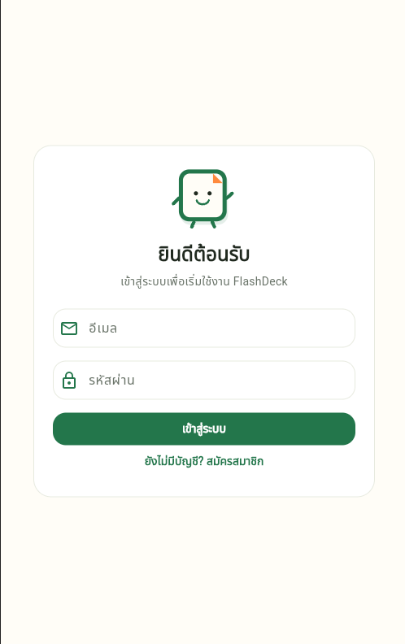

# FlashDeck

FlashDeck คือแอปบัตรคำสำหรับช่วยจัดเก็บและทบทวนสิ่งที่เรียน สร้างชุดบัตร
เพิ่มหมวดหมู่และบัตรคำของตัวเอง แล้วทบทวนผ่านแอป Android ได้
ข้อมูลบัญชี ชุดบัตร หมวดหมู่ และบัตรคำจัดเก็บผ่าน Supabase

## ผู้จัดทำ

- DaniVerse ([@Danielth999](https://github.com/Danielth999))

## ดาวน์โหลดและเอกสาร

- [ดาวน์โหลด APK รุ่นล่าสุด](https://github.com/Danielth999/Flash-Deck/releases/latest)
- [รายงาน PDF ในโฟลเดอร์ docs](docs/) — ยังไม่มีไฟล์รายงาน PDF ใน repository
- [ภาพหน้าจอตัวอย่างในโฟลเดอร์ screenshots](screenshots/) — จะเพิ่มภาพจริงภายหลัง

## ภาพหน้าจอ

ขณะนี้ยังไม่มีภาพ screenshot ของแอปใน repository จึงยังไม่แสดงภาพตัวอย่าง
เมื่อเพิ่มไฟล์แล้ว สามารถแทรกภาพใน README ได้ เช่น:

```html



```

## ฟีเจอร์

- สมัครสมาชิกและเข้าสู่ระบบด้วยอีเมล/รหัสผ่าน
- สร้าง แก้ไข และลบชุดบัตร พร้อมเลือกหมวดหมู่หรือปล่อยเป็น “ยังไม่จัดหมวด”
- เพิ่ม แก้ไข ลบ และค้นหาบัตรคำในแต่ละชุด
- สร้าง เปลี่ยนชื่อ และลบหมวดหมู่ของบัญชี
- ทบทวนบัตร: เปิดดูคำตอบ แล้วปัดขวาเมื่อจำได้หรือปัดซ้ายเพื่อทบทวนอีก
  และยังมีปุ่มสำหรับส่งคำตอบโดยไม่ใช้การปัด
- ดูผลรอบทบทวนจากจำนวนบัตรทั้งหมด จำนวนที่จำได้ จำนวนที่เหลือ
  และจำนวนครั้งที่ตอบ
- ใช้งานผ่านแถบนำทาง ชุดบัตร / หมวดหมู่ / บัญชี

## วิธีทำงาน

1. สมัครบัญชี แล้วกลับมาหน้าเข้าสู่ระบบเพื่อ Login
2. สร้างชุดบัตรและจัดหมวดหมู่ตามต้องการ
3. เพิ่มคำถามและคำตอบในชุดบัตร
4. เริ่มทบทวน เปิดคำตอบ แล้วเลือก “จำได้” หรือ “ทบทวนอีก”
5. ดูผลสรุปเมื่อจบรอบ แล้วเลือกทบทวนใหม่หรือกลับไปชุดบัตร

เมื่อเลือก “ทบทวนอีก” บัตรจะย้ายไปท้ายคิว ส่วน “จำได้” จะนำบัตรออกจากคิว
และนับบัตรนั้นเพียงครั้งเดียวในรอบนั้น จำนวน attempts นับเฉพาะการตอบที่ยืนยันแล้ว
ผลทบทวนไม่ใช่คะแนนความถูกต้อง และประวัติผลรอบไม่ได้บันทึกถาวรในฐานข้อมูล

## เทคโนโลยีและโครงสร้างข้อมูล

- Flutter และ Dart สำหรับแอป
- Supabase Auth และ PostgreSQL สำหรับบัญชีและข้อมูล โดยการแยกข้อมูลผู้ใช้
  ต้องอาศัย RLS ที่ตั้งค่าไว้ใน Supabase
- รายการบัตรในหน้ารายการเก็บและกรองด้วย `List`
- การทบทวนใช้ `Queue` จัดลำดับบัตร และ `Set<String>` เก็บ ID
  ของบัตรที่จำได้เพื่อไม่นับซ้ำ
- การเรียงบัตรตามคำถามใช้ stable Insertion Sort; การเปรียบเทียบข้อความใช้
  `String.compareTo` จึงไม่ใช่การเรียงภาษาไทยแบบพจนานุกรมเต็มรูปแบบ
- Deck อ้างหมวดหมู่ด้วย `category_id`; เมื่อเป็น `NULL` จะแสดง
  “ยังไม่จัดหมวด” โดยไม่ใช้ชื่อหมวด legacy

## ติดตั้งและรันจาก Source

ต้องติดตั้ง Flutter SDK และ Android SDK ก่อน จาก root ของโปรเจ็กต์:

```powershell
flutter pub get
```

สร้างไฟล์ `config.json` ที่ root โดยใช้ Supabase URL และ publishable key
ของโปรเจ็กต์ที่ตั้งค่าฐานข้อมูลและ RLS สำหรับแอปนี้แล้ว:

```json
{
  "SUPABASE_URL": "https://YOUR_PROJECT.supabase.co",
  "SUPABASE_PUBLISHABLE_KEY": "YOUR_PUBLISHABLE_KEY"
}
```

จากนั้นรันหรือ build:

```powershell
flutter run --dart-define-from-file=config.json
flutter analyze
flutter test
flutter build apk --release --dart-define-from-file=config.json
```

`config.json` ถูก ignore โดย `.gitignore`; ห้ามใส่ `service_role` หรือ secret
key ในแอปหรือ commit ลง GitHub หากสมัครแล้วไม่มี session ให้ตรวจการตั้งค่า
Confirm email ใน Supabase Dashboard ตามการตั้งค่าของโปรเจ็กต์

ไอคอน Android/iOS สร้างจาก `assets/icon/flashdeck.jpg` หากเปลี่ยนภาพ ให้รัน:

```powershell
dart run flutter_launcher_icons
```

APK ที่ build ในเครื่องจะอยู่ที่
`build\app\outputs\flutter-apk\app-release.apk`
แอปปิด Impeller เพื่อใช้ Skia ช่วยรองรับ emulator บางรุ่น เช่น MuMu

## ข้อจำกัดและหมายเหตุ

- APK ใน Releases ใช้ debug signing สำหรับติดตั้งทดสอบ ไม่ใช่ signing
  สำหรับเผยแพร่บน Play Store
- ไม่ได้ตั้งค่าการส่งอีเมลและ callback สำหรับลืมรหัสผ่าน
- Supabase schema/RLS ต้องเตรียมไว้แล้ว โฟลเดอร์ `supabase/drafts`
  เป็นไฟล์ร่างสำหรับอ้างอิงเท่านั้น: **ห้ามนำไปรันซ้ำกับฐานข้อมูลที่ migrate แล้ว**
- รายงาน PDF และภาพหน้าจอตัวอย่างยังไม่ได้เพิ่ม ดูสถานะใน
  [docs/README.md](docs/README.md) และ [screenshots/README.md](screenshots/README.md)
