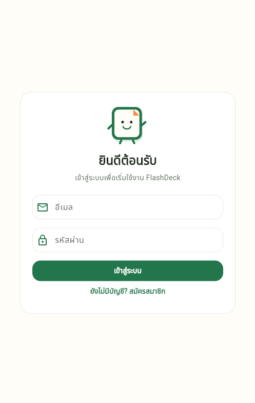
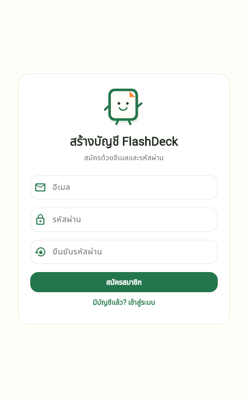
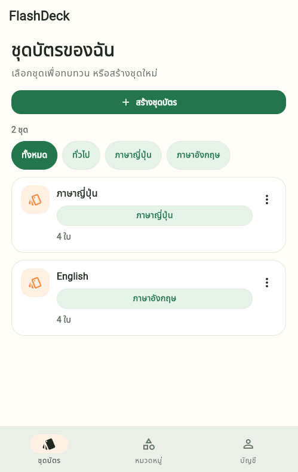
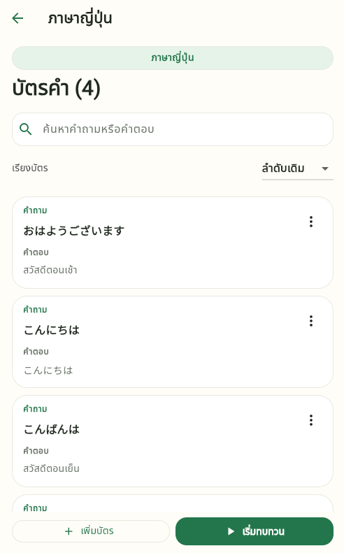
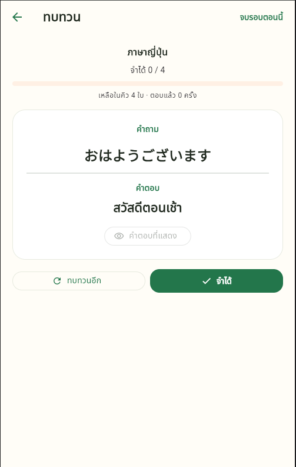
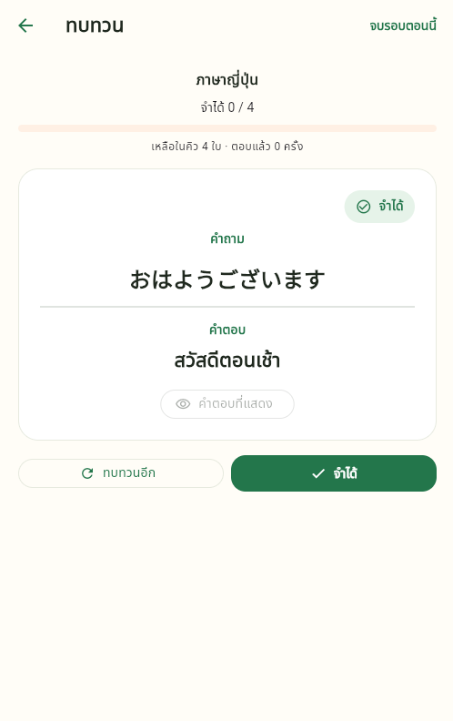
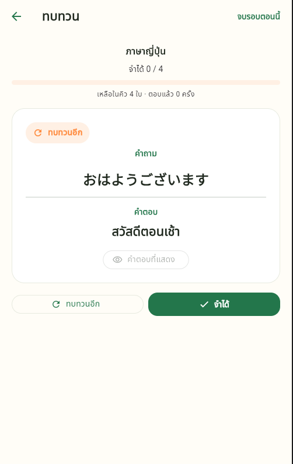
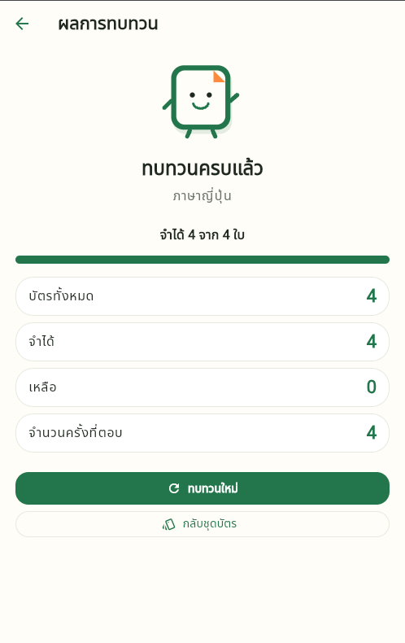
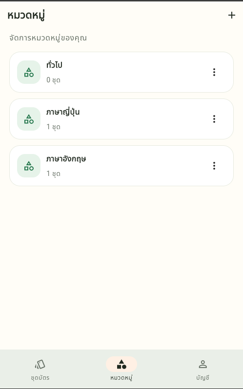
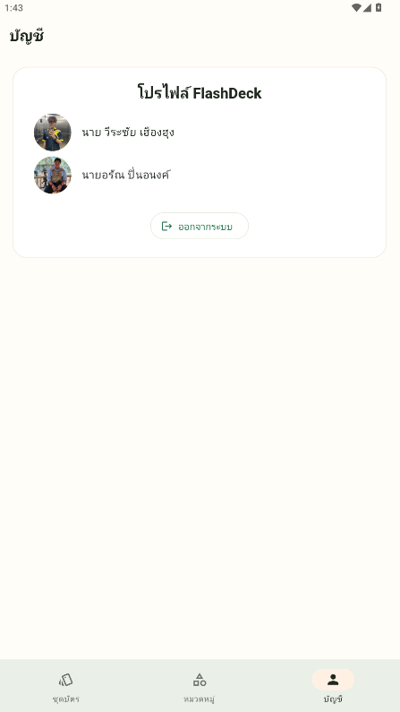

# FlashDeck

FlashDeck คือแอปพลิเคชันบัตรคำ (Flashcard) สำหรับช่วยจัดเก็บและทบทวนความรู้ ช่วยให้คุณสร้างชุดบัตร จัดหมวดหมู่ และเพิ่มเนื้อหาบัตรคำได้อย่างอิสระ ทบทวนผ่านแอปพลิเคชัน Android พร้อมระบบจัดการคิวการเรียนรู้ที่มีประสิทธิภาพ ข้อมูลบัญชี ชุดบัตร หมวดหมู่ และบัตรคำทั้งหมดจะถูกจัดเก็บอย่างปลอดภัยผ่าน Supabase

---

## ดาวน์โหลดและเอกสาร

- 📱 [ดาวน์โหลดไฟล์ APK รุ่นล่าสุด](https://github.com/Danielth999/Flash-Deck/releases/latest)
- 📄 [รายงานวิจัย/โครงการ PDF (โฟลเดอร์ docs)](docs/report.pdf)
- 🖼️ [คลังภาพหน้าจอทั้งหมด (โฟลเดอร์ screenshots)](screenshots/)
- 🖼️ [วิดิโอแนะนำ](https://drive.google.com/file/d/1QTQqldDH1Y5Qxh3V0xPJ1xc84YueHiL2/view?usp=sharing)

---

## ผู้จัดทำ

- **นายวีระชัย เฮืองฮุง** (รหัสนักศึกษา 016840641010-5)
- **นายอรัณ  ปิ่นอนงค์** (รหัสนักศึกษา 016840641009-7)

---

## ภาพหน้าจอตัวอย่าง

  
  
  
  
  
  
  
  
  
  

---

## ฟีเจอร์หลัก

- **ระบบผู้ใช้งาน:** สมัครสมาชิกและเข้าสู่ระบบด้วยอีเมลและรหัสผ่าน (Authentication via Supabase)
- **การจัดการชุดบัตร:** สร้าง แก้ไข และลบชุดบัตร พร้อมเลือกจัดหมวดหมู่หรือกำหนดเป็น “ยังไม่จัดหมวด”
- **การจัดการบัตรคำ:** เพิ่ม แก้ไข ลบ และค้นหาบัตรคำภายในแต่ละชุดได้อย่างสะดวก
- **การจัดการหมวดหมู่:** สร้าง เปลี่ยนชื่อ และลบหมวดหมู่ส่วนตัวของแต่ละบัญชี
- **ระบบทบทวนบัตร:** 
  - เปิดดูคำตอบ แล้วเลือกปัดขวาเมื่อ **“จำได้”** หรือปัดซ้ายเพื่อ **“ทบทวนอีก”**
  - มีปุ่มกดสำหรับส่งคำตอบทางเลือกเพิ่มเติมโดยไม่ต้องใช้ท่าทางปัด
- **สรุปผลการเรียนรู้:** แสดงผลหลังจบการทบทวน ได้แก่ จำนวนบัตรทั้งหมด, จำนวนที่จำได้, จำนวนที่เหลือ และจำนวนครั้งที่ตอบ (Attempts)
- **การนำทางที่ง่ายดาย:** เมนูหลักรองรับการสลับไปมาระหว่าง หน้าชุดบัตร / หมวดหมู่ / บัญชีผู้ใช้

---

